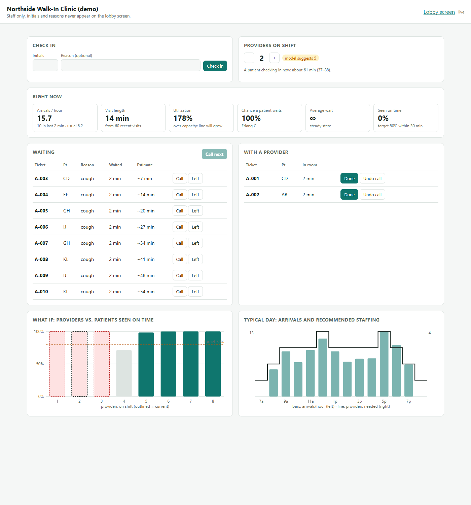
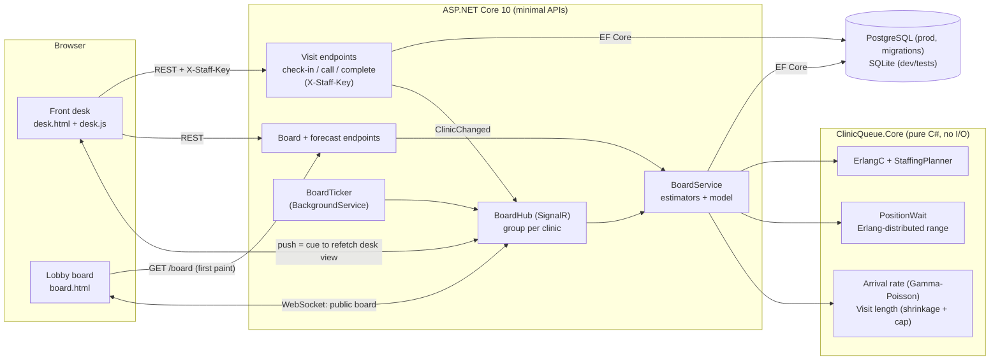
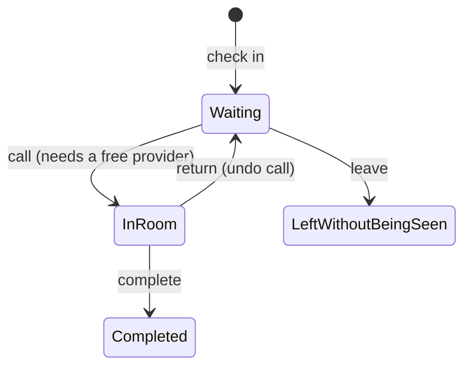

# ClinicQueue

**Live walk-in wait times for urgent care and community clinics, from a queueing model instead of a guess.**

[](https://github.com/yashchhabra57/clinicqueue/actions/workflows/ci.yml)

Walk-in clinics usually post one number on the door ("current wait: about 45 minutes") that someone updates by hand when they remember. It is wrong for most people in the room: the person who just got called and the person who just walked in see the same number. And when the line backs up, nobody can say whether one more provider would fix it or whether it needs two.

ClinicQueue gives the front desk a check-in screen and the lobby a live board. Every ticket gets its own estimate with a likely range ("about 14 min, 4 to 27"), the board updates the moment someone is called, and the desk sees whether today's staffing can meet the clinic's goal (for example "80% of patients seen within 30 minutes") and how many providers it would take.



*The front-desk console on the seeded demo clinic (synthetic data). The lobby screen shows the same queue with ticket codes only.*

## What it does

- **Check in, call, complete.** Front desk enters initials and an optional reason; the patient gets a ticket (`A-007`). Staff call the next patient (first come, first served), mark visits done, undo a mistaken call, or record a walkout.
- **Per-ticket wait estimates with a range.** Each place in line gets a mean and a 10th to 90th percentile range based on how many visits have to finish before that patient is called.
- **Live lobby board.** A public page for the waiting-room TV or a phone: "now serving", the queue by ticket code, and what someone walking in right now should expect. Pushed over SignalR (WebSockets) on every change.
- **Staffing advice.** Erlang C tells the desk the chance a patient waits at all, the average wait, and the share seen within the target. The "what if" chart shows that for every head count; the day plan recommends staffing hour by hour from the clinic's own history.
- **Privacy by construction.** Initials and reasons exist only on staff endpoints. The hub and the public board carry ticket codes only, and check-in rejects anything longer than three letters so full names never get typed in.

## Architecture



The queueing math lives in `ClinicQueue.Core`, a class library with no database, web or clock dependencies, so it is tested with exact reference values. The API project reads the queue, feeds the estimators, and shapes two views of the same snapshot: a staff `DeskBoard` and a `PublicBoard` with personal details removed.

## The math, briefly

A walk-in clinic is a textbook **M/M/c queue**: patients arrive at random (rate λ per hour), each visit takes a random time (mean S minutes), and c providers see patients first come, first served.

| Question | How ClinicQueue answers it |
|---|---|
| How busy are we? | Offered load a = λ·S/60 (in "providers' worth" of demand); utilization ρ = a/c. If ρ ≥ 1 the line grows without limit. |
| Will a new patient wait at all? | Erlang C, computed from Erlang B with the stable recurrence B(k) = a·B(k−1)/(k + a·B(k−1)) so it never overflows (`a^c/c!` breaks a double past c ≈ 170). |
| How long on average, and what share is seen within T? | Wq = C/(c/S − λ/60) and P(wait > T) = C·e^(−(c/S − λ/60)·T). |
| How many providers do we need? | The smallest c whose service level meets the target (it rises with c, so a scan from ⌊a⌋+1 is exact). |
| When will *ticket A-012* be seen? | With k people ahead and f free rooms, n = k − f + 1 visits must end first. While every room is busy, visits end at rate c/S, so the wait is Erlang(n, c/S): mean n·S/c, and the 10th and 90th percentiles come from inverting its CDF by bisection (summed in log space so long lines don't underflow). |

The inputs are estimated, not configured:

- **Arrival rate** blends the clinic's history for this hour of day (a prior worth one hour of observation) with today's actual check-ins in the last hour: λ = (historical·1 + recent count)/(1 + window hours). Early in the day it trusts history; as check-ins accumulate it follows today. The window starts at the first check-in today, so a clinic that opened ten minutes ago isn't averaged over a closed hour.
- **Visit length** is the mean of the last 60 completed visits, each capped at 4× the clinic default (a provider who forgets to click "done" shouldn't create a 3-hour visit) and shrunk toward the default as if 10 default-length visits had already been seen.

## Tech stack

| Layer | Choice |
|---|---|
| Language / runtime | C# 14, .NET 10 |
| Web | ASP.NET Core minimal APIs, ProblemDetails errors, endpoint filters |
| Real time | ASP.NET Core SignalR (WebSockets with automatic fallback), one group per clinic |
| Data | EF Core 10; PostgreSQL via Npgsql with migrations, SQLite for zero-setup dev and fast tests |
| Concurrency | Optimistic concurrency tokens on visits and clinics; atomic `ExecuteUpdate` ticket counter |
| Frontend | Vanilla ES modules, hand-rolled SVG charts, light/dark CSS |
| Testing | xUnit, `WebApplicationFactory`, `FakeTimeProvider`, SignalR .NET client; the same API suite runs on SQLite and PostgreSQL |
| Quality | Nullable reference types, `TreatWarningsAsErrors`, .NET analyzers (`latest-recommended`), `dotnet format` in CI |
| Ops | Multi-stage Dockerfile (non-root), docker compose with PostgreSQL 16, GitHub Actions |

## API

Staff endpoints need the `X-Staff-Key` header. Errors are RFC 9457 problem details (`400` validation, `401` missing key, `404` unknown clinic or visit, `409` illegal transition, rooms full, or a concurrent edit).

| Method | Path | Who | What |
|---|---|---|---|
| GET | `/api/clinics` | public | List clinics |
| GET | `/api/clinics/{slug}/board` | public | Lobby board: ticket codes, estimates, now serving |
| GET | `/api/clinics/{slug}/desk` | staff | Full queue with initials, reasons and the model's inputs |
| GET | `/api/clinics/{slug}/forecast?within=&level=` | staff | Service level for each head count + hour-by-hour plan; optional what-if target |
| POST | `/api/clinics/{slug}/visits` | staff | Check in `{ "initials": "JD", "reason": "sore throat" }` → `201` with ticket |
| POST | `/api/clinics/{slug}/visits/call-next` | staff | Call the longest-waiting patient |
| POST | `/api/clinics/{slug}/visits/{id}/call` | staff | Call a specific patient (e.g. triage) |
| POST | `/api/clinics/{slug}/visits/{id}/complete` | staff | Visit finished |
| POST | `/api/clinics/{slug}/visits/{id}/return` | staff | Undo a call; they keep their place in line |
| POST | `/api/clinics/{slug}/visits/{id}/leave` | staff | Left without being seen |
| PUT | `/api/clinics/{slug}/staffing` | staff | `{ "providersOnShift": 3 }` |
| WS | `/hubs/board` | public | `Join(slug)` returns the board; `board` messages push updates |
| GET | `/healthz` | public | Liveness |

Visit lifecycle:



## Run it

Requires the [.NET 10 SDK](https://dotnet.microsoft.com/download).

```bash
dotnet run --project src/ClinicQueue.Api --launch-profile http
# open http://localhost:5183 — the demo clinic is seeded with four weeks of synthetic history
# front-desk key in Development: dev-staff-key
```

Tests:

```bash
dotnet test                                   # core math + API on in-memory SQLite
CLINICQUEUE_TEST_POSTGRES="Host=localhost;Username=postgres;Password=postgres;Database=postgres" \
  dotnet test tests/ClinicQueue.Api.Tests     # same API suite on PostgreSQL, one throwaway database per test class
```

Production-like stack on PostgreSQL:

```bash
cp .env.example .env    # set STAFF_API_KEY
docker compose up --build
# http://localhost:8080
```

Configuration (environment variables use `__` for nesting): `Database__Provider` (`Sqlite`|`Postgres`), `ConnectionStrings__ClinicQueue`, `Staff__ApiKey` (required outside Development; the app refuses to start without it), `Seed__Demo`, `Board__TickSeconds`. See `.env.example`.

## Engineering notes

- **Two views of one snapshot.** `BoardService` builds a single `DeskBoard`; `PublicBoard.From` projects it down to ticket codes. The hub only ever sends the public projection, so it needs no auth, and front-desk screens treat each push as a cue to re-fetch the staff view over an authenticated request. A test asserts initials and reasons never appear in the public JSON.
- **Room capacity under concurrency.** Two desks calling patients for the last free room would each see "one room free". Every call rewrites the clinic's concurrency token, so the second `SaveChanges` fails with `409` instead of over-filling rooms. Tests reproduce both races with two DbContexts.
- **The ticket counter bug I found by running it.** The first version incremented the counter in C# and relied on the concurrency token, retrying on conflict. Hitting the running app with parallel check-ins produced `409`s, and on PostgreSQL an 8-way burst still exhausted the retries. The fix moves the increment into one `UPDATE ... SET LastTicketNumber = CASE WHEN TicketDay = @today THEN LastTicketNumber + 1 ELSE 1 END` inside a transaction (EF Core `ExecuteUpdate`), which row-locks on PostgreSQL. The regression test fires simultaneous check-ins and checks the tickets are exactly `A-001..A-008`.
- **Time is injected.** Everything reads `TimeProvider`; tests use `FakeTimeProvider` to cross local midnight in Chicago and check that ticket numbers reset, or to space out check-ins and verify the arrival-rate blend by hand.
- **Migrations for PostgreSQL, `EnsureCreated` for SQLite.** Production schema changes are versioned; CI fails if the model changes without a migration (`dotnet ef migrations has-pending-model-changes`). SQLite is a dev/test convenience built from the same model.
- **Lobby first paint over HTTP.** The board fetches `/board` before opening the WebSocket, so a TV that boots before the network settles never shows a blank screen, and it falls back to polling if the hub is unreachable.

## Limitations (honest)

- **The model is M/M/c.** Real visit lengths are not exponential (they're closer to lognormal), so the ranges are approximate; the per-ticket range also ignores how long current visits have already run. Arrivals within an hour are treated as steady.
- **First come, first served only.** Real urgent care triages by acuity; "call a specific patient" exists, but estimates assume FIFO.
- **One shared staff key per deployment**, not per-user accounts or audit of who called whom.
- **The hourly profile ignores day of week** and is recomputed on every board build (fine for one clinic's four weeks of rows; it should be cached or pre-aggregated at scale).
- **Single instance.** SignalR groups live in memory; running several API instances needs a Redis backplane.
- **Demo data is synthetic.** Nothing here has been validated against a real clinic's arrival logs.

## Roadmap

- Triage levels (ESI) with a priority queue and per-level estimates
- Fit visit length as lognormal per reason; use elapsed time of in-progress visits (conditional residual time)
- Day-of-week profiles and a cached, pre-aggregated arrival history table
- SMS "you're next" notifications through a durable outbox
- Per-user staff accounts (OIDC) and an audit log
- Redis backplane for horizontal scaling

## License

MIT
